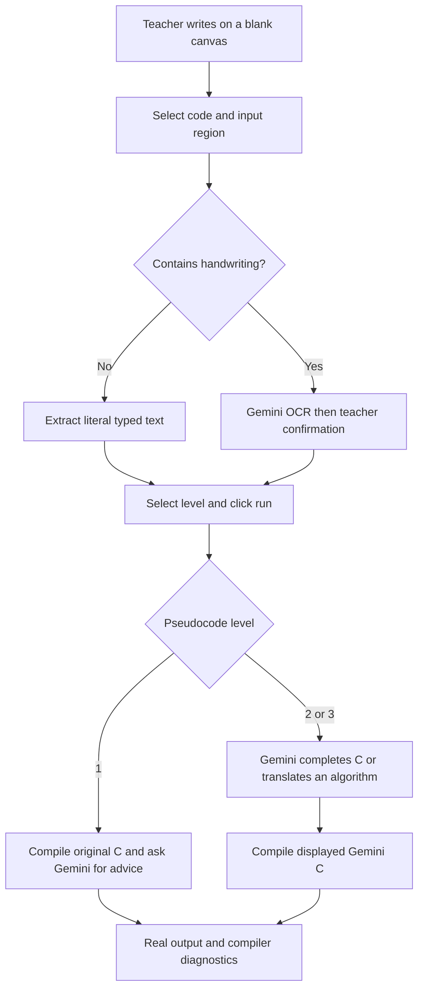

# Boardroom: Technical Stack and Project Overview

This document describes the implementation currently in `whiteboard-code-verifier/`. The original concept is recorded in `../../whiteboard-code-verifier.md`; some of its proposed features remain future work.

## 1. Purpose and target user

Boardroom is an executable digital whiteboard for teachers explaining C++ and Python programming. A teacher writes or types on a blank canvas, selects a code/input region from the top bar, supplies input in blue, and runs the program without moving the lesson into a separate IDE. Compiler messages and runtime diagnostics point back to locations on the board.

The teaching goal is to make classroom examples verifiable: demonstrate working code, expose syntax and memory mistakes, and connect abstractions to their implementation. The current input is an Excalidraw canvas. A camera pipeline for physical whiteboards is outside the implemented scope.

## 2. Technology stack

| Layer | Technology in this repository | Responsibility |
| --- | --- | --- |
| Application UI | React and React DOM 18.3.1 | Canvas integration, frame selection, source review, execution state, and results |
| Whiteboard | `@excalidraw/excalidraw` 0.18.0 | Freehand strokes, typed text, frames, element geometry, and canvas image exports |
| Frontend language | JavaScript ES modules and JSX | Browser application and shared board helpers |
| Styling | Plain CSS | Responsive page layout, inspector, terminal, review controls, and diagnostic presentation |
| Development/build | Vite 8.2.2 | Frontend development server, API proxy, and production assets |
| API runtime | Node.js 22.12+ | HTTP endpoints, validation, Gemini requests, and Docker orchestration |
| Handwriting recognition | Gemini API; default `gemini-3.6-flash` | Image transcription into structured code/input lines |
| Execution boundary | Linux Docker Engine locally; configured Wandbox service on Vercel | Isolated C execution outside the application process |
| Compiler image | `gcc:14.2.0-bookworm` | GCC toolchain and Debian-based execution environment |
| Runner implementation | Python 3 standard library | Compilation, input delivery, deadlines, output collection, and diagnostic parsing |
| Program languages | C++17 and Python 3 | C uses GCC/sanitizers; Python uses isolated syntax checking and interpretation |
| Runtime checks | AddressSanitizer, UndefinedBehaviorSanitizer, and leak detection | Detect supported memory errors, undefined behavior, and leaks during execution |
| Tests | Node's test runner, Python `unittest`, Playwright 1.64.1 | Unit, compiler, container, and browser checks |

Frontend dependencies are pinned in `package.json` and `package-lock.json`. The Dockerfile pins a compiler image tag, rather than an immutable image digest. Node's API and the Python runner use built-in modules; there is no Express server or Gemini SDK dependency. The backend calls Gemini through `fetch` and its REST API.

The Vercel deployment also includes same-origin Functions for health, OCR, Gemini pseudocode assistance, and C/Python execution. They are public and require no login or access token. Vercel uses an explicitly configured third-party Wandbox service for execution and the GitHub Git Data API for persistent Snapshot/History storage. `SNAPSHOT_GITHUB_REPOSITORY`, optional `SNAPSHOT_GITHUB_BRANCH`, and a server-only `SNAPSHOT_GITHUB_TOKEN` with Contents read/write configure the archive. Without archive credentials, History shows the missing configuration. See [Vercel serverless deployment](vercel-serverless.md). The Docker implementation below remains the full local/persistent-server mode; its sanitizers and resource limits do not describe the hosted compiler.

## 3. Architecture and data flow



The browser owns the working scene and its review state. The Node process owns credentials and coordinates external services. The container owns compilation and execution. Gemini receives relevant image crops; it does not decide whether a program is correct. GCC and runtime tools supply the execution evidence.

## 4. Whiteboard and source extraction

The initial scene is empty. **Select code & input** activates Excalidraw’s native frame tool, allowing the teacher to drag around existing code and optional blue stdin. The new frame becomes the selected program; writing outside it remains excluded. Demo lessons remain available through the lesson selector.

The workspace fills the browser viewport beneath compact controls. Browser fullscreen and a hideable side panel provide more drawing space. The panel divider supports pointer dragging and keyboard resizing. Writing frames have explicit width/height controls, a **More room** action, and **Fit frame** navigation. Editing typed source in the side panel grows the frame to contain the program and positions typed stdin below it. Shrinking cannot clip existing frame contents. The source textarea also supports vertical resizing.

- Black/default code ink (`#1e1e1e` or `#000000`) supplies C source.
- Blue ink (`#1971c2`) supplies standard input.
- Other colors serve as annotations and are excluded from extraction and OCR captures.

For typed text, `src/board.js` orders text elements by position and preserves their text, including blank lines. It also constructs a source map from compiler line numbers to text-element coordinates. Typed-only channels bypass OCR entirely.

For handwritten channels, `src/capture.js` exports the relevant strokes and any text in that same channel. Code and stdin are captured separately, with padding and a white background. Frame borders and verifier overlays are excluded. Crops at or below 1,800 pixels retain their native dimensions; larger crops are reduced proportionally to that longest-side limit. PNG encoding remains lossless; the API accepts PNGs up to 2,048 × 2,048.

### Language selection

The right panel's C/Python radio toggle sets a fixed `c` or `python` value. `src/languages.js` shares supported IDs, source filenames and payload defaults. Omitted language fields retain C behavior. Signatures include Python mode so old C results and pending proposals cannot be reused across language changes. Changing the language clears handwriting confirmation, and saved scenes restore their language; legacy scenes default to C.

The API forwards Python requests to the same isolated Docker runner locally and to Wandbox's configured Python runtime on Vercel. Python syntax checking preserves original line numbers; exception tracebacks map back to board lines. Python uses the same input, output, time, network and container limits as C, with no C header validation or sanitizer claims. Gemini receives Python-specific transcription and assistance instructions at every level. Python snapshots store `board.py` and a language-tagged manifest; replay passes that language to the frozen runner. Existing C snapshots and manifests remain supported.

### Gemini pseudocode levels

`src/pseudocode.js` defines Full program, Snippet, and Algorithm modes. Full program compiles the editor source directly; Snippet wraps it in the selected template. Algorithm explicitly asks Gemini for a complete C++17 or Python demonstration before compiling. A failed run offers an explicit Gemini fix action. Generated and corrected code is displayed separately; the original drawing is retained.

`server/pseudocode.mjs` uses the same Gemini Interactions API, key, and model as OCR. It enforces input/output bounds, validates structured C/explanation/issue fields, and logs only safe duration, quota, and token metadata. `server/gemini-response.mjs` shares bounded response parsing and quota classification with OCR. Both local `/api/pseudocode` and the authenticated Vercel function prepare C without executing it. The browser uses the separate `/api/run` endpoint for execution. Handwritten source must first be transcribed and confirmed. Scene fingerprints prevent a changed board from launching pending generated C; changing the level marks previous output stale. Generated C has its own line numbers and never highlights unrelated board lines. Cases at Levels 2–3 uses the current generated source.

## 5. OCR and teacher review

`server/ocr.mjs` calls Gemini's Interactions REST endpoint using the backend-only `GEMINI_API_KEY`. `OCR_MODEL` can override the default model. The request asks for structured JSON containing separate `code` and `stdin` arrays. Each line contains:

| Field | Meaning |
| --- | --- |
| `text` | The transcribed line, preserving indentation and visible mistakes |
| `box` | Approximate line bounds as `[y_min, x_min, y_max, x_max]`, normalized to 0–1000 |
| `uncertain` | A model-reported ambiguity flag |
| `alternatives` | Up to three alternative readings of the same line |

The prompt explicitly forbids adding missing headers, `main()`, ampersands, semicolons, braces, or inferred statements. This matters because silently repairing a teacher's mistake would defeat the verifier's purpose. The prompt cannot guarantee faithful transcription, so review is mandatory.

`src/HandwritingPanel.jsx` presents the captured image and editable lines. Teachers can correct text, inspect alternate readings, and insert or remove lines. They must acknowledge checking both code and input, then select **Use confirmed code**. A separate **Verify & run** action submits that text for execution.

Recognition and execution are independent endpoints. Reading handwriting or confirming it never launches the compiler. Scene fingerprints tie confirmation to the reviewed frame contents. New or changed ink invalidates confirmation. Immutable scene snapshots prevent Excalidraw's in-place stroke updates from associating a transcription with an outdated scene.

Ambiguity flags are not calibrated confidence scores. Line boxes are model estimates, so handwriting diagnostics identify approximate board regions. The adapter validates text sizes, line counts, coordinate ranges, and response completeness. It requests `store: false`; account-level provider data handling still follows Gemini's applicable terms.

The researched alternatives—Cloud Vision, Mistral OCR, MyScript, PaddleOCR, TrOCR, and OpenAI vision—are compared in [OCR options](ocr-options.md). Gemini is the implemented provider; no multi-provider routing or accuracy ranking is implemented.

## 6. Compilation and execution

`server/sandbox.mjs` creates a fresh `whiteboard-runner:local` container for each request. Inside it, `runner/runner.py` writes the source to a temporary `board.cpp`, validates includes, and invokes g++ with flags including:

```text
-std=c++17 -g -O0 -Wall -Wextra -fno-omit-frame-pointer
-fsanitize=address,undefined -fno-sanitize-recover=all
```

The runner adds its trusted library directory to the include path and links the math library with `-lm`. Compilation must succeed before execution begins. The submitted stdin is delivered through a pipe; when exhausted, the program receives EOF. There is no interactive terminal session.

| Control | Current setting |
| --- | --- |
| Source/input size | 32 KiB source; 8 KiB stdin |
| Compilation deadline | 10 seconds |
| Execution deadline | 5 seconds wall time |
| Runtime CPU limit | 3-second soft limit; 4-second hard limit |
| Output threshold | 16 KiB; oversized output is reported and returned streams are bounded |
| Container memory/CPU | 512 MiB; one CPU |
| Process limit | 64 |
| Temporary filesystem | 64 MiB writable `/tmp` |
| Privileges | UID/GID 65534, dropped capabilities, no new privileges |
| Filesystem/network | Read-only root; container networking disabled; no host directory mounts |

The Node layer applies a 22-second outer runner deadline and removes the named container afterward, including timeout cases. Production submissions execute only inside Docker. These controls support the local prototype; public arbitrary-code execution would require a separate deployment and isolation design.

## 7. Diagnostics and teaching features

The runner parses GCC messages, sanitizer output, and curated-library contract failures into structured diagnostics. Results include status, stdout, stderr, compiler output, exit code, duration, diagnostics, and teaching notes.

Typed source lines map directly to element geometry. Legacy OCR line boxes can project through the capture's bounds onto approximate canvas coordinates; current compact OCR returns text only, so handwritten diagnostics stay in the editor. Clicking a diagnostic focuses a board region only when a location exists. Editing source, input, or relevant geometry marks old results stale and removes their highlights. Added review lines can lack an original board location.

The bundled header-only libraries provide an integer stack (`stack.h`), a singly linked integer list (`linked_list.h`), a growing circular integer queue (`queue.h`), and binary search with lower/upper bounds on sorted arrays (`search.h`). These are project-provided teaching extensions rather than ISO C standard-library headers. Public operation macros pass `__LINE__` so contract failures identify the teacher's callsite. The **Libraries** tab exposes the compiled header sources, method lists, and runnable examples. See the [C library reference](c-libraries.md) for APIs, ownership rules, preconditions, and complexity.

Teaching notes are deterministic pattern matches for operations such as `malloc`, `free`, `realloc`, `scanf`, `fgets`, `memcpy`, and stack operations. Comments and string literals are ignored. The current implementation does not use an AST parser or an LLM to generate these notes. The memory demonstration visualizes actual addresses printed by its program; it does not inspect arbitrary process memory or determine glibc heap/mmap regions.

The **Cases** tab runs up to 20 cases sequentially. Each has an expected status and optional stdout comparison (exact by default, surrounding-whitespace trimming, or whitespace normalization). Results show progress, expected/actual output, first mismatch, durations and diagnostics; edits mark results stale. Definitions persist in per-language browser storage and can be imported/exported as validated version-1 JSON. Stop aborts the browser wait and prevents further submissions; it cannot guarantee cancellation of already submitted server work. Completed cases retain their automatic full-board snapshots; suite definitions are not snapshot assets.

Six starter lessons demonstrate input/output, a use-after-free error, an empty-stack contract failure, linked-list traversal/insertion, FIFO queue operations, and binary search with duplicate bounds. Rule-based teaching notes also explain list ownership, queue growth, and the sorted-array search precondition.

## 8. API and configuration

| Endpoint | Responsibility |
| --- | --- |
| `GET /api/health` | Report Docker runner readiness and OCR configuration availability |
| `POST /api/ocr` | Recognize supplied code/input PNG data URLs; return an unconfirmed transcription |
| `POST /api/run` | Compile and execute `{ "source": "...", "stdin": "..." }` |
| `GET /api/library/<name>` | Serve an allowlisted public teaching header: `stack.h`, `linked_list.h`, `queue.h`, or `search.h` |
| `POST /api/snapshots` | Save a dated lesson folder and Git commit from the supplied scene |
| `GET /api/snapshots` | List the latest 30 snapshot commits |
| `GET /api/snapshots/<id>` | Read the committed Excalidraw scene for a saved lesson |
| `GET /api/snapshots/<id>/libraries` | Compare allowlisted headers committed with that lesson to the current application copies |
| `GET /api/snapshots/sync` | Report local and remote lesson history sync state |
| `POST /api/snapshots/sync` | Queue an immediate push retry when an archive remote is configured |

OCR permits one request in flight and six attempts per minute, with a 4 MiB request-body limit and a 50-second provider deadline, leaving time to return a JSON error before the hosted function limit. Execution permits two requests in flight and 20 attempts per minute. These limits are process-local and reset when the server restarts.

OCR failures include safe diagnostic metadata in the API response and an expandable UI panel. The backend logs `[ocr:gemini]` records with HTTP status, duration, quota classification, and numeric per-request token usage on success. Provider-reported token limits, generic quota/rate limits, and depleted credits are distinguished; a timeout leaves quota status unknown. Logs omit credentials, images, transcriptions, and raw error payloads. Remaining project quota must be checked in AI Studio.

The server binds to loopback and checks request hosts and origins. Hosted frontends configure an HTTPS reverse proxy and exact `BOARDROOM_APP_ORIGIN`. API access is public; browser requests omit credentials, and the previous `BOARDROOM_API_TOKEN` setting is ignored. Only the public API origin uses a `VITE_` build variable. Gemini and GitHub keys stay in server-only environment settings and are never mounted into execution containers. `PORT` overrides the API default of 8787. Health indicates configured credentials, not guaranteed provider availability. See [Docker API deployment](docker-api-deployment.md).

OCR now requests low thinking and compact `{text, uncertain}` lines. It preserves the review API shape with null geometry and empty alternatives for text-only responses. Teacher review and editor diagnostics remain available; current text-only recognition supplies no canvas line positions. Live paired speed/accuracy verification is pending available provider quota.

## 9. Storage and repository organization

After each completed execution response, the client automatically archives the full canvas captured just before that run. Each input case creates a separate snapshot. `scene.verifier.execution` records the submitted language, source, stdin, level, run/case kind, and browser-reported result. Shared snapshot validation checks this metadata and retains handwriting-review requirements. Replay files and vendored headers follow the submitted source, including editor/template/Gemini changes; `board.excalidraw` retains all original frames, strokes, annotations and assets. Failures are visible independently of compiler results. This is an archive of completed responses, not a persistent offline retry queue.

The hosted adapter in `server/github-snapshots.mjs` shares validation and replay-bundle preparation with the disk store. It creates a Git tree based on the latest branch commit, creates one commit for the entire folder, and advances only the archive branch without force. Conflicting saves retry against the winning parent. Reads and comparisons use GitHub commit references, so no warm function, background queue, or temporary disk is required. The token stays server-side, and all classroom users share the same archive. Lesson visibility follows repository visibility. Vercel Git deployments are disabled for `boardroom-lessons`.

There is no application database or user-account system. Hosted lesson persistence uses a configured GitHub repository; the local server uses a separate Git archive on disk. The working board is held in browser application state. Teachers can download its Excalidraw-compatible scene or use **Snapshot** to save `board.excalidraw`, `board.cpp` or `board.py`, and `input.txt` on the API server. Snapshot folders are grouped by UTC date, with a time/title/unique suffix for each save. Source and input are derived from the selected frame; handwritten source requires a matching confirmed transcription. Saving does not require successful compilation or a working Docker runner.

On the local server, the archive is a separate Git repository under `snapshots/`, initialized on first save. Each snapshot creates one commit containing its board files and replay bundle. **History** lists the latest 30 commits and opens their saved scenes. Opening restores the selected frame but requires fresh execution and, for handwriting, review. Git failures preserve the saved files and produce a visible warning. `SNAPSHOT_DIR` can relocate the archive. New snapshots vendor referenced curated headers and their trusted internal dependencies into `lib/`, freeze `runner.py` (including compilation flags), and save a `lib.lock` manifest with SHA-256 file hashes and an immutable GCC image reference. `build.sh` invokes the standard-library `replay.py` to check integrity before a Docker build and constrained run. No submitted program executes on the host; replay uses no host mounts and disables container networking. The image must be available locally or downloadable for the first build. A copied snapshot can replay without the application checkout.

Snapshot creation remains independent of compilation, Docker, and OCR credentials. Literal includes are scanned conservatively (including inactive conditional branches), with comment/continuation handling; standard headers are supplied by the pinned compiler image. `ocr.json` retains confirmed recognition/review provenance when present. A matching current result is also saved as browser-reported `result.json`; it is historical evidence, not trusted verification. All files are committed together, while Git failures still preserve written files. Manifest hashes detect changes relative to the manifest, not malicious replacement of the manifest and scripts.

Existing three-file snapshots remain readable. Opening History restores an editable scene and uses current application libraries for subsequent UI execution; frozen replay currently uses the saved shell script. The History tab can read each committed header beside the current copy and show whether it changed; old three-file snapshots report that no bundle is available. Git synchronization pushes committed lessons to the `boardroom-lessons` branch when the snapshot repository has an `origin` remote. Local commits serve as the durable queue; a private Git ref records the last successful push. Sync retries on server startup, after saves, and every minute. Pushes never force an update, so remote divergence requires manual resolution. The History tab reports status and offers a retry action. Library semver management remains unimplemented.

```text
src/                 React UI, board extraction, capture, review, and overlays
server/              HTTP API, Gemini adapter, and Docker orchestration
runner/              Dockerfile, Python runner, and trusted C header
scripts/             Development launcher, font setup, and smoke checks
tests/               Node/Python tests, browser checks, and synthetic OCR sample
docs/                Technical overview and OCR research
public/fonts/        Generated local copies of Excalidraw fonts
dist/                Generated production frontend
snapshots/           Local lesson files and their separate Git history (ignored by app Git)
```

Hackathon submission materials live outside the application directory.

## 10. Development and verification

From the application root:

```bash
npm ci
npm run runner:build
npm run dev
```

Development serves the frontend at `http://127.0.0.1:5173` and the API at `http://127.0.0.1:8787`. Vite proxies `/api` requests to Node. Excalidraw fonts are copied locally during development/build setup. For a production frontend served by the Node process, run `npm run build`, then `npm start`.

| Command | Verification scope |
| --- | --- |
| `npm test` | Node API/mapping/OCR tests and Python runner tests using fixed repository-owned C fixtures |
| `npm run test:docker` | Actual container lessons, EOF handling, timeout, output limits, and leak detection |
| `npm run test:browser` | Production frontend, review workflow, import/export, responsive layout, and real Docker runs |
| `npm run test:ocr -- tests/fixtures/ocr/synthetic-code.png` | Opt-in live Gemini request; prints unconfirmed text without executing it |
| `npm run benchmark:ocr -- /path/to/private/manifest.json` | Opt-in live Gemini measurements against private classroom samples |

Implementation verification passed 84 Node/Python tests and 43 browser tests; the Docker runner also passes its dedicated execution checks. Coverage includes pointer/keyboard panel resizing, browser fullscreen, a 151-line program with input contained in its expanded frame, public and committed header browsing, multiple input cases, all six examples, and saving/reopening real Git-backed snapshots. Snapshot failure cases preserve written files and unrelated staged application changes. The browser suite stubs OCR and Gemini code assistance explicitly, while using real Docker execution. A separate live Gemini check faithfully transcribed a seven-line synthetic handwriting-style sample, including its intentional missing `&` and semicolon. A live browser check also exercised capture, Gemini, teacher correction/confirmation, and Docker execution with stdout `3`.

These results establish the working integration. The new benchmark command computes character, line, and critical-symbol errors from private sample images and gold transcriptions, plus optional teacher-reported correction time; no genuine classroom samples have been provided or measured. Other material limits are restricted includes, approximate handwriting highlights, unbenchmarked Gemini code-generation quality, browser-local input suites, no collaboration or individual authentication, and no public multi-tenant deployment. Caveman gateway observability is not connected in the current implementation.
