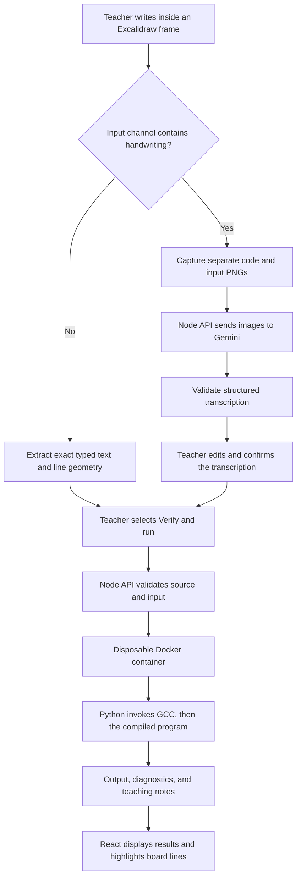

# Boardroom: Technical Stack and Project Overview

This document describes the implementation currently in `whiteboard-code-verifier/`. The original concept is recorded in `../../whiteboard-code-verifier.md`; some of its proposed features remain future work.

## 1. Purpose and target user

Boardroom is an executable digital whiteboard for teachers explaining C programming. A teacher writes or types a program inside a whiteboard frame, supplies input in blue, and runs the program without moving the lesson into a separate IDE. Compiler messages and runtime diagnostics point back to locations on the board.

The teaching goal is to make classroom examples verifiable: demonstrate working code, expose syntax and memory mistakes, and connect abstractions to their implementation. The current input is an Excalidraw canvas. A camera pipeline for physical whiteboards is outside the implemented scope.

## 2. Technology stack

| Layer | Technology in this repository | Responsibility |
| --- | --- | --- |
| Application UI | React and React DOM 18.3.1 | Canvas integration, frame selection, source review, execution state, and results |
| Whiteboard | `@excalidraw/excalidraw` 0.18.0 | Freehand strokes, typed text, frames, element geometry, and canvas image exports |
| Frontend language | JavaScript ES modules and JSX | Browser application and shared board helpers |
| Styling | Plain CSS | Responsive page layout, inspector, terminal, review controls, and diagnostic presentation |
| Development/build | Vite 8.2.2 | Frontend development server, API proxy, and production assets |
| API runtime | Node.js 22.12+ | HTTP endpoints, validation, Gemini requests, and Docker orchestration |
| Handwriting recognition | Gemini API; default `gemini-3.8-flash` | Image transcription into structured code/input lines |
| Execution boundary | Linux Docker Engine | Disposable, resource-constrained containers for submitted C programs |
| Compiler image | `gcc:14.2.0-bookworm` | GCC toolchain and Debian-based execution environment |
| Runner implementation | Python 3 standard library | Compilation, input delivery, deadlines, output collection, and diagnostic parsing |
| Program language | C11 | Full programs compiled with warnings and runtime sanitizers |
| Runtime checks | AddressSanitizer, UndefinedBehaviorSanitizer, and leak detection | Detect supported memory errors, undefined behavior, and leaks during execution |
| Tests | Node's test runner, Python `unittest`, Playwright 1.64.1 | Unit, compiler, container, and browser checks |

Frontend dependencies are pinned in `package.json` and `package-lock.json`. The Dockerfile pins a compiler image tag, rather than an immutable image digest. Node's API and the Python runner use built-in modules; there is no Express server or Gemini SDK dependency. The backend calls Gemini through `fetch` and its REST API.

## 3. Architecture and data flow



The browser owns the working scene and its review state. The Node process owns credentials and coordinates external services. The container owns compilation and execution. Gemini receives relevant image crops; it does not decide whether a program is correct. GCC and runtime tools supply the execution evidence.

## 4. Whiteboard and source extraction

One Excalidraw frame represents one program. The teacher selects which frame to verify.

The workspace fills the browser viewport beneath compact controls. Browser fullscreen and a hideable side panel provide more drawing space. The panel divider supports pointer dragging and keyboard resizing. Writing frames have explicit width/height controls, a **More room** action, and **Fit frame** navigation. Editing typed source in the side panel grows the frame to contain the program and positions typed stdin below it. Shrinking cannot clip existing frame contents. The source textarea also supports vertical resizing.

- Black/default code ink (`#1e1e1e` or `#000000`) supplies C source.
- Blue ink (`#1971c2`) supplies standard input.
- Other colors serve as annotations and are excluded from extraction and OCR captures.

For typed text, `src/board.js` orders text elements by position and preserves their text, including blank lines. It also constructs a source map from compiler line numbers to text-element coordinates. Typed-only channels bypass OCR entirely.

For handwritten channels, `src/capture.js` exports the relevant strokes and any text in that same channel. Code and stdin are captured separately, with padding and a white background. Frame borders and verifier overlays are excluded. Exported images are scaled to a maximum dimension of 1,800 pixels; the API accepts PNGs up to 2,048 × 2,048.

## 5. OCR and teacher review

`server/ocr.mjs` calls Gemini's Interactions REST endpoint using the backend-only `GEMINI_API_KEY`. `OCR_MODEL` can override the default model. The request asks for structured JSON containing separate `code` and `stdin` arrays. Each line contains:

| Field | Meaning |
| --- | --- |
| `text` | The transcribed line, preserving indentation and visible mistakes |
| `box` | Approximate line bounds as `[y_min, x_min, y_max, x_max]`, normalized to 0–1000 |
| `uncertain` | A model-reported ambiguity flag |
| `alternatives` | Up to three alternative readings of the same line |

The prompt explicitly forbids adding missing headers, `main()`, ampersands, semicolons, braces, or inferred statements. This matters because silently repairing a teacher's mistake would defeat the verifier's purpose. The prompt cannot guarantee faithful transcription, so review is mandatory.

`src/HandwritingPanel.jsx` presents the captured image and editable lines. Teachers can correct text, inspect alternate readings, and insert or remove lines. They must acknowledge checking both code and input, then select **Use confirmed code**. A separate **Verify & run** action submits that text for execution.

Recognition and execution are independent endpoints. Reading handwriting or confirming it never launches the compiler. Scene fingerprints tie confirmation to the reviewed frame contents. New or changed ink invalidates confirmation. Immutable scene snapshots prevent Excalidraw's in-place stroke updates from associating a transcription with an outdated scene.

Ambiguity flags are not calibrated confidence scores. Line boxes are model estimates, so handwriting diagnostics identify approximate board regions. The adapter validates text sizes, line counts, coordinate ranges, and response completeness. It requests `store: false`; account-level provider data handling still follows Gemini's applicable terms.

The researched alternatives—Cloud Vision, Mistral OCR, MyScript, PaddleOCR, TrOCR, and OpenAI vision—are compared in [OCR options](ocr-options.md). Gemini is the implemented provider; no multi-provider routing or accuracy ranking is implemented.

## 6. Compilation and execution

`server/sandbox.mjs` creates a fresh `whiteboard-runner:local` container for each request. Inside it, `runner/runner.py` writes the source to a temporary `board.c`, validates includes, and invokes GCC with flags including:

```text
-std=c11 -g -O0 -Wall -Wextra -fno-omit-frame-pointer
-fsanitize=address,undefined -fno-sanitize-recover=all
```

The runner adds its trusted library directory to the include path and links the math library with `-lm`. Compilation must succeed before execution begins. The submitted stdin is delivered through a pipe; when exhausted, the program receives EOF. There is no interactive terminal session.

| Control | Current setting |
| --- | --- |
| Source/input size | 32 KiB source; 8 KiB stdin |
| Compilation deadline | 10 seconds |
| Execution deadline | 5 seconds wall time |
| Runtime CPU limit | 3-second soft limit; 4-second hard limit |
| Output threshold | 16 KiB; oversized output is reported and returned streams are bounded |
| Container memory/CPU | 512 MiB; one CPU |
| Process limit | 64 |
| Temporary filesystem | 64 MiB writable `/tmp` |
| Privileges | UID/GID 65534, dropped capabilities, no new privileges |
| Filesystem/network | Read-only root; container networking disabled; no host directory mounts |

The Node layer applies a 22-second outer runner deadline and removes the named container afterward, including timeout cases. Production submissions execute only inside Docker. These controls support the local prototype; public arbitrary-code execution would require a separate deployment and isolation design.

## 7. Diagnostics and teaching features

The runner parses GCC messages, sanitizer output, and curated-library contract failures into structured diagnostics. Results include status, stdout, stderr, compiler output, exit code, duration, diagnostics, and teaching notes.

Typed source lines map directly to element geometry. OCR line boxes project through the capture's bounds back onto canvas coordinates. Clicking a diagnostic focuses its region. Editing source, input, or relevant geometry marks old results stale and removes their highlights. Added review lines can lack an original board location.

The bundled header-only libraries provide an integer stack (`stack.h`), a singly linked integer list (`linked_list.h`), a growing circular integer queue (`queue.h`), and binary search with lower/upper bounds on sorted arrays (`search.h`). These are project-provided teaching extensions rather than ISO C standard-library headers. Public operation macros pass `__LINE__` so contract failures identify the teacher's callsite. The **Libraries** tab exposes the compiled header sources, method lists, and runnable examples. See the [C library reference](c-libraries.md) for APIs, ownership rules, preconditions, and complexity.

Teaching notes are deterministic pattern matches for operations such as `malloc`, `free`, `scanf`, and stack operations. The current implementation does not use an AST parser or an LLM to generate these notes. The memory demonstration visualizes actual addresses printed by its program; it does not inspect arbitrary process memory or determine glibc heap/mmap regions.

Six starter lessons demonstrate input/output, a use-after-free error, an empty-stack contract failure, linked-list traversal/insertion, FIFO queue operations, and binary search with duplicate bounds. Rule-based teaching notes also explain list ownership, queue growth, and the sorted-array search precondition.

## 8. API and configuration

| Endpoint | Responsibility |
| --- | --- |
| `GET /api/health` | Report Docker runner readiness and OCR configuration availability |
| `POST /api/ocr` | Recognize supplied code/input PNG data URLs; return an unconfirmed transcription |
| `POST /api/run` | Compile and execute `{ "source": "...", "stdin": "..." }` |
| `GET /api/library/<name>` | Serve an allowlisted public teaching header: `stack.h`, `linked_list.h`, `queue.h`, or `search.h` |

OCR permits one request in flight and six attempts per minute, with a 4 MiB request-body limit and a 60-second provider deadline. Execution permits two requests in flight and 20 attempts per minute. These limits are process-local and reset when the server restarts.

The server binds to loopback and checks request hosts and origins. The local `.env` contains `GEMINI_API_KEY` and optional `OCR_MODEL`; it is ignored by Git. Keys are never prefixed with `VITE_`, sent to the browser, or mounted into execution containers. `PORT` overrides the API's default port of 8787. A health response indicates that OCR credentials are configured, not that every future provider request will succeed.

## 9. Storage and repository organization

There is no application database, user-account system, or cloud lesson store. The working board is held in browser application state. Teachers preserve it by downloading an Excalidraw-compatible JSON scene containing elements, reviewed OCR provenance, and the current run result when valid. Imported scenes require fresh recognition/review and execution; saved confirmation is not trusted. Automatic Git-backed lesson history remains future work.

```text
src/                 React UI, board extraction, capture, review, and overlays
server/              HTTP API, Gemini adapter, and Docker orchestration
runner/              Dockerfile, Python runner, and trusted C header
scripts/             Development launcher, font setup, and smoke checks
tests/               Node/Python tests, browser checks, and synthetic OCR sample
docs/                Technical overview and OCR research
public/fonts/        Generated local copies of Excalidraw fonts
dist/                Generated production frontend
```

Hackathon submission materials live outside the application directory.

## 10. Development and verification

From the application root:

```bash
npm ci
npm run runner:build
npm run dev
```

Development serves the frontend at `http://127.0.0.1:5173` and the API at `http://127.0.0.1:8787`. Vite proxies `/api` requests to Node. Excalidraw fonts are copied locally during development/build setup. For a production frontend served by the Node process, run `npm run build`, then `npm start`.

| Command | Verification scope |
| --- | --- |
| `npm test` | Node API/mapping/OCR tests and Python runner tests using fixed repository-owned C fixtures |
| `npm run test:docker` | Actual container lessons, EOF handling, timeout, output limits, and leak detection |
| `npm run test:browser` | Production frontend, review workflow, import/export, responsive layout, and real Docker runs |
| `npm run test:ocr -- tests/fixtures/ocr/synthetic-code.png` | Opt-in live Gemini request; prints unconfirmed text without executing it |

The most recent implementation verification passed 40 Node/Python tests, 14 Docker checks, and 19 browser tests. Coverage includes pointer/keyboard panel resizing, browser fullscreen, a 151-line program with input contained in its expanded frame, public header browsing, and all six examples. The browser suite stubs OCR responses explicitly, while using real Docker execution. A separate live Gemini check faithfully transcribed a seven-line synthetic handwriting-style sample, including its intentional missing `&` and semicolon. A live browser check also exercised capture, Gemini, teacher correction/confirmation, and Docker execution with stdout `3`.

These results establish the working integration. Human handwriting accuracy, critical-symbol error rates, and correction time still require a benchmark on genuine classroom samples. Other material limits are full-C-program input only, restricted includes, approximate handwriting highlights, no automatic code repair, no collaboration or authentication, and local-only deployment. Caveman gateway observability is not connected in the current implementation.
